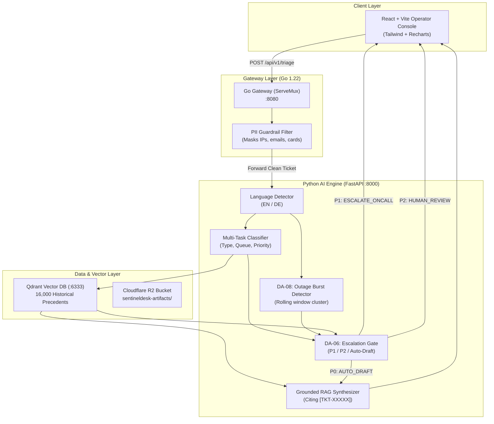
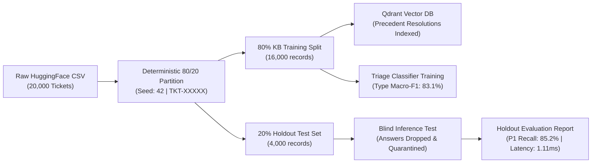
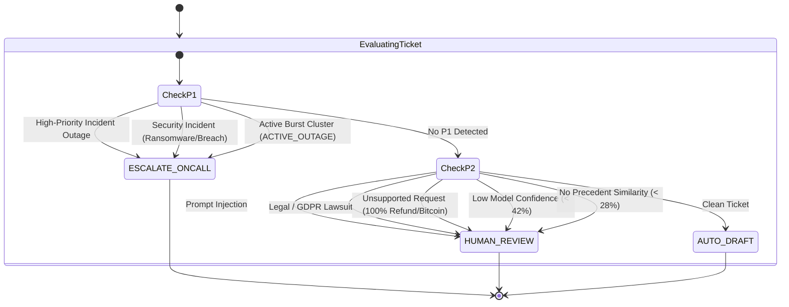

# DA-11: SentinelDesk Architecture Diagrams & Slide Visuals
**Owner**: Data Analyst  
**Project**: SentinelDesk (Hackathon 5-Hour Build)  
**Repository**: `Dogtags27/gdg-sentinal`

---

## 1. End-to-End System Architecture

---

## 2. Zero-Leakage Data Partition Flow (ML-03 / DA-01)

---

## 3. Escalation Policy State Machine (DA-06 / DA-07)

---

## 4. 5-Minute Live Judge Presentation Deck Outline

| Slide / Segment | Visual / Graphic | Talking Point (30s each) |
| :--- | :--- | :--- |
| **1. The Problem (0:00 - 0:30)** | Hospital VPN outage ticket lost in queue | Operations struggle with triage bottlenecks and generative AI hallucinations. |
| **2. Architecture (0:30 - 1:00)** | Slide 1 Architecture Diagram | Series-circuit pipeline: Go Gateway $\rightarrow$ Python Engine $\rightarrow$ Qdrant RAG $\rightarrow$ Escalation Gate. |
| **3. Live Outage Demo (1:00 - 2:00)** | React Console: Red P1 Banner | German Telemedicine VPN failure: triggers `ESCALATE_ONCALL` with cluster burst detection. |
| **4. Grounded Auto-Draft (2:00 - 3:00)** | React Console: Green Auto-Draft | Routine password reset: Instant grounded resolution citing precedent `[TKT-14714]`. |
| **5. Defense & Benchmarks (3:00 - 4:30)** | Insights Tab (DA-10 charts) | Zero data leakage, **83.1% Macro-F1**, **85.2% Outage Recall**, **1.11 ms** latency. |
| **6. Wrap-up (4:30 - 5:00)** | Team Q&A slide | Commercial alignment with SentinelDeskHQ principles. |
EOF